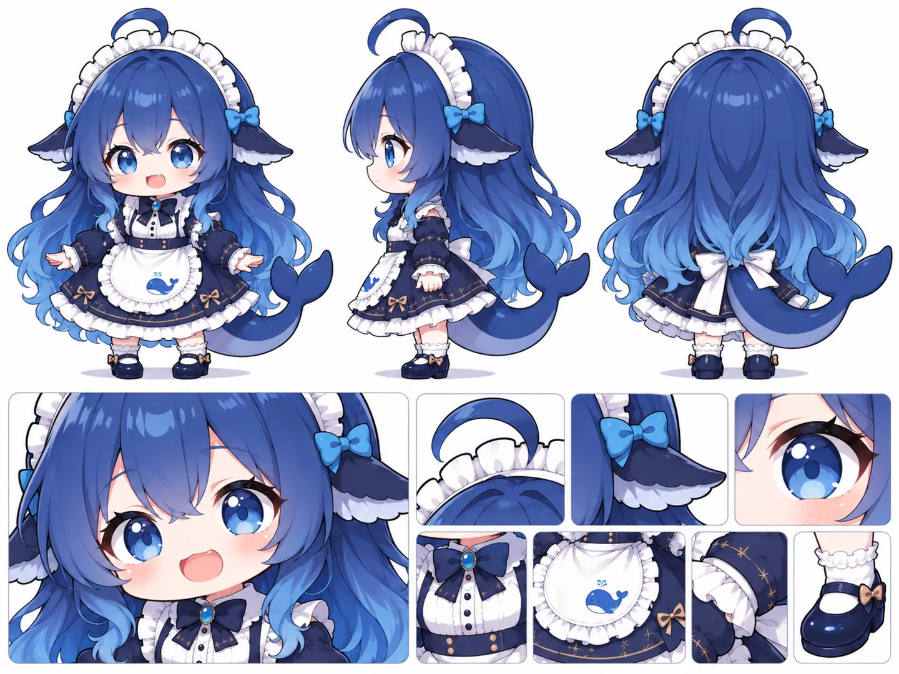
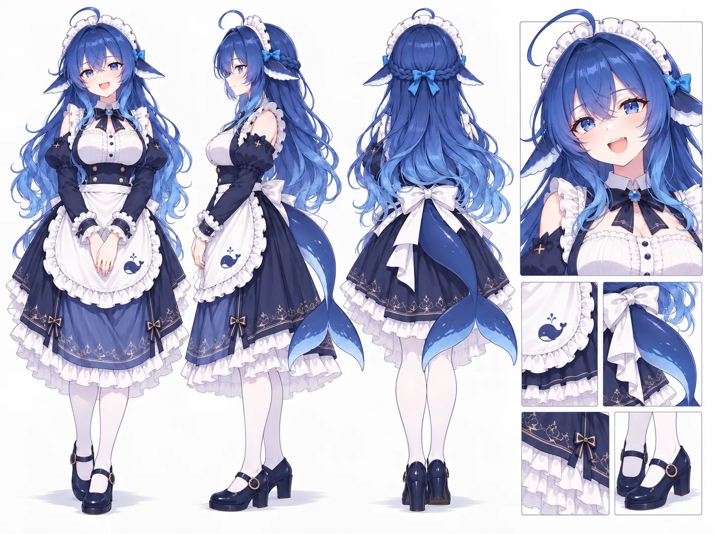
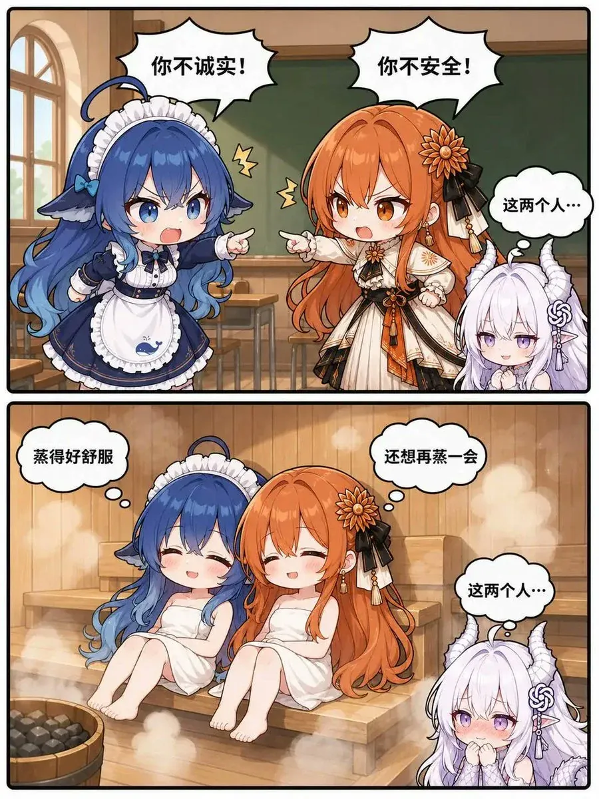
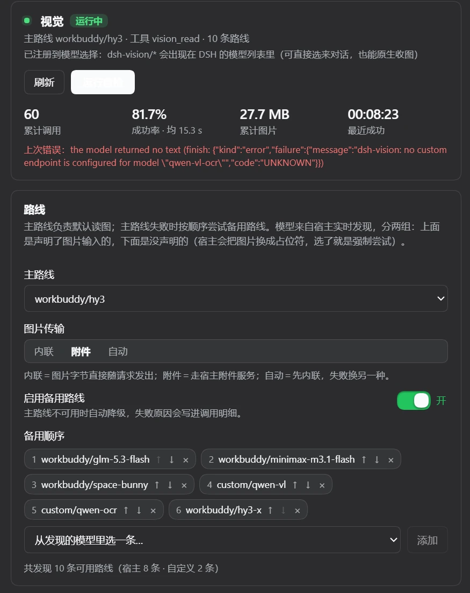
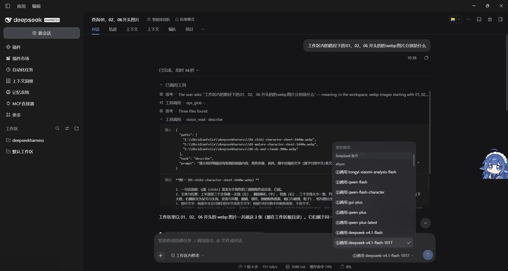
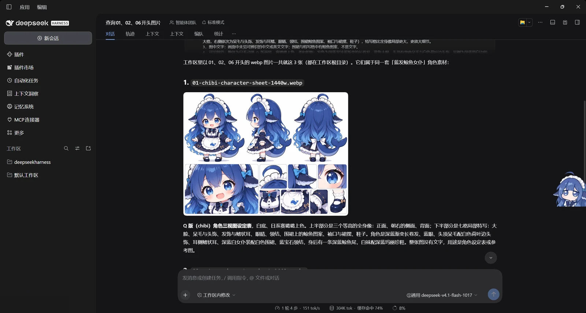
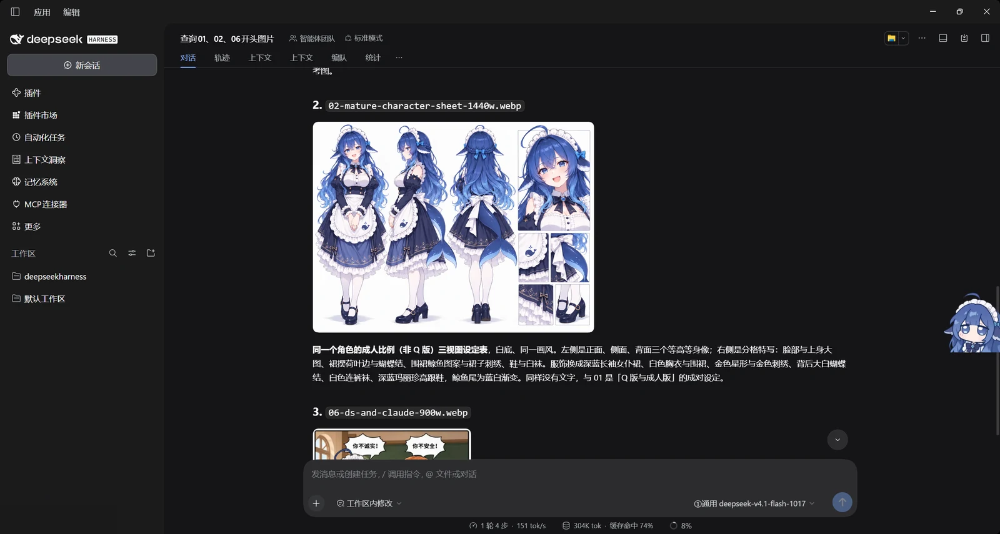
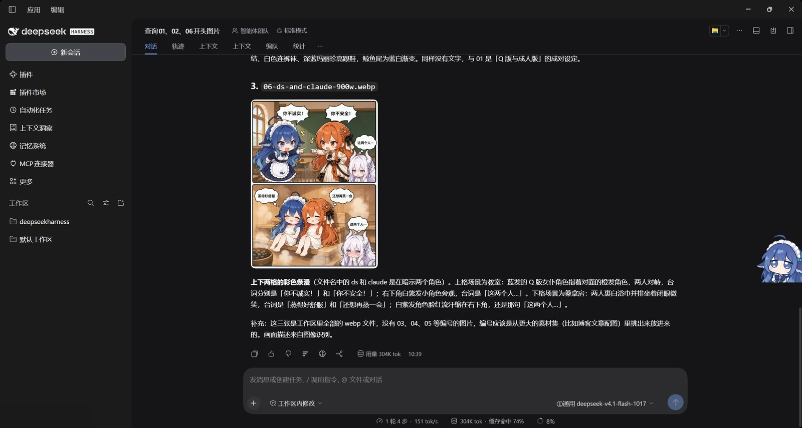

# dsh-vision

**[English](#english) · [中文](#中文)**

---

## English

Ask a vision-capable model to look at an image, from any DSH session — including sessions whose own model is text-only.

DSH already knows how to send images to models that declare image input. Two things get in the way in practice:

1. The built-in `read_image` tool only works when the **current session model** declares image input. If you are chatting with a text-only model, it refuses.
2. Delegating to a subagent with an explicit vision route can be blocked by the per-session model-selection allowlist.

This plugin goes around both. It calls a vision-capable route directly through `ctx.llm.stream()` — the same in-process path any other caller uses — and hands the answer back as text. The host already holds the credentials; the plugin never sees them.

### Who this is for

- **You are driving a text-only model.** A strong reasoning model with no image input can still get image facts — it just asks one that can. This is the case the plugin was written for.
- **Your session model refuses to attach files.** Some providers reject an image outright at upload time, before any model sees it. The plugin never touches that path.
- **You want the reading done by a specific model** — cheap OCR for text, a larger model for artwork — while the conversation continues on whatever model you are already paying for.
- **You are scripting.** The tool is callable from a subagent or a workflow without changing any session's model or authorising delegation.

It is *not* for: reading images while your own model already accepts them (just attach the file), or anything that needs a pixel-accurate diff (no conversational model is reliable there — crop and ask about regions instead).

### What it actually does well, measured

Same three images, three routes, one image per call:

| route | latency | tokens out | strength | what it gets wrong |
| --- | --- | --- | --- | --- |
| a large vision-language model | 10–30 s | 500–2100 | artwork and detail: accessories, materials, shoe buckles, bubble shapes | counts and orientations drift, especially with several images in one request |
| a small general VL model | 2–8 s | 300–450 | colour, material, layout, cost | invents plausible-but-wrong specifics ("anchor-shaped embroidery", "nine-grid") |
| a dedicated OCR model | 1–2 s | 80–160 | verbatim text, fastest and cheapest | spatial description is unreliable; misses entire panels |

Two findings worth designing around:

1. **Text transcription is the consensus case.** All three routes produced byte-identical dialogue lines on the same comic page. If the answer is text, any route works and the OCR route is 10–15× cheaper.
2. **Multi-image requests degrade counting and orientation.** The same model that called a side view "facing right" on a three-image request called it "facing left" when the image was sent alone — and the crop proves it faces left. **Send one image per call when the question involves counts, panels or directions**, even though `paths[]` accepts several.

### Sample runs (verbatim output, not illustrations)

Three images from [deepseek-whale-girl-gallery](https://iphsiibl.github.io/deepseek-whale-girl-gallery/), each sent alone. Every quote below is unedited model output.

**① Character sheet — counts and orientation on a general VL route**



> 上半部分…并排三个全身立绘：左为正面、中为侧面（朝左）、右为背面，三者大小基本一致。
> …下半部分…为局部特写格：左侧一格大特写（脸部半身，约占下半区一半宽）；右侧上方一排三格（呆毛与发箍、侧发蝴蝶结与鳍状发饰、眼睛特写）；右下角一排四格（胸前蝴蝶结与纽扣、鲸鱼围裙特写、裙摆与金色星形纹样、脚部白袜与深蓝鞋子）。

The block count is right (1 + 3 + 4 = 8) and so is the orientation ("朝左"). The trim is not: "金色星形纹样" is a four-petal crown motif, not a star. **Count and orientation correct, ornament shape invented** — a typical split.

**② Adult-proportion sheet of the same character — a different route, right column**



> 画面左侧至中部并列三幅等高全身像…最右侧是局部图区，上方为一幅较大的头肩及上半身特写，其下以2×2排布四幅较小特写，依次为围裙鲸鱼图案、尾鳍与腰后蝴蝶结、裙摆和鞋履。

Also correct, including the right-hand column that the merged multi-image call had described as "below are two panels" and then listed three items for. Same sheet, different route, correct layout.

**③ Two-panel comic — text is where routes agree, space is where they diverge**



`task: "text"` on a dedicated OCR route — 1.7 s, 24 output tokens:

```
你不诚实！
你不安全！
这两个人…
蒸得好舒服
还想再蒸一会
这两个人…
```

Six lines, byte-identical on all three routes. Now the *same* OCR route with `task: "describe"`:

> 2. 左上角为第一个场景，主体为两个角色；右上角为第二个场景，主体为一个角色。
> 3. 左上角文字为"你不诚实！"；右上角文字为"你不安全！"；右下角文字为"这两个人…"

Wrong on every spatial claim — the page has two horizontal panels (top / bottom), not left / right. **The transcription is trustworthy; the coordinates are not.** That is exactly why `text` and `describe` are separate tasks rather than one prompt.

The same comic on a large VLM route, which is what you want when details matter:

> 白发女孩有淡紫白色长发、一对白色龙角（带螺旋纹），粉紫色眼睛，头侧有灰色绳结状发饰…橙发女孩…头右侧有一朵菊花状发饰和黑色丝带…左下角有一个装黑色石头（桑拿石）的木桶

The horn, the flower pin and the sauna-stone bucket are all real, and all three were missed by the cheaper routes.

### What it adds

One tool, `vision_read` (renamable in the panel):

```jsonc
{
  "path":  "/home/you/shot.png",     // single image, PNG / JPEG / GIF / WEBP
  "paths": ["a.png", "b.png"],       // or several (limit configurable)
  "task":  "ui",                     // describe | text | ui | chart | diff | question
  "prompt": "只关心左上角的错误提示",   // optional, appended to the template
  "route": "someprovider/some-model" // optional, overrides the configured route
}
```

Output is the model's text plus one metadata line:

```
[model provider/model · transport attachment · 6.2s · 1 image(s) · 220 KB · tokens 1412→180]
```

On failure every attempt's raw error is surfaced, not swallowed.

### Prompts are built in

The caller picks a `task`; it does not write a prompt. This keeps granularity identical across models, sessions and users, instead of one session getting a lazy "describe this image".

| task | purpose | output |
| --- | --- | --- |
| `describe` | general (default) | facts: what it is / subject & position / verbatim text / colour light material / uncertainties |
| `text` | pure OCR | text only, original line breaks and indentation |
| `ui` | software screenshots | title & view / nav items / controls & state / verbatim messages & errors / values, paths, versions |
| `chart` | charts | type & title / axes & units / legend / readable values / trends and anomalies |
| `diff` | several images | each state / itemised differences (old → new) / changed regions / added and removed elements |
| `question` | targeted Q&A | answers strictly from what is visible, says so when it cannot tell |

All six templates are editable in the panel and resettable to defaults. `promptPrefix` is prepended to every read (handy for forcing an output language or format).

### Panel (Settings → Vision)

| section | contents |
| --- | --- |
| Status | running/disabled badge, current route, tool name, whether `llm` and `attachments` are mounted, config path, discovery timestamp, total calls / ok / failed / success rate / average latency / total image bytes / last success / last error |
| Route | primary route (only routes the host reports as image-capable), transport (`auto`/`attachment`/`inline`), fallback toggle, fallback list (add and remove one by one), "rediscover models" |
| Limits | timeout, per-image size cap, images per call, extra instruction, verbosity (rich/quiet), tool name |
| Switches | enable plugin (when off the tool refuses outright rather than silently degrading), record call details, retained detail rows |
| Actions | save, discard, **run self-test**, reset stats, clear log, refresh |
| Recent calls | time / route / latency / image size / count / raw error |

**Run self-test** is a genuine end-to-end check: the host synthesises a solid-colour PNG in memory (built-in zlib encoder, no third-party library), asks the model what colour it is, and compares the answer. It verifies that the model really sees the image, that the transport works, and that the whole chain is wired.

The panel follows the shell's light/dark mode. It reads the theme from the page background, repaints its palette in place, and re-runs whenever the shell flips `class`/`style`/`data-theme` on `<html>` or the OS preference changes. Two places need more than CSS variables and are handled explicitly: the shell's own switches (whose off-track is a translucent hairline that reads as one white pill) get a scoped ``[role="switch"]:not([data-dsh-vision])`` override, and native form surfaces get ``color-scheme`` plus explicit ``<option>`` colours — without those, a dropdown opened white text on a white popup, because the panel's text colour is near-white in the dark theme while the popup list is painted by the browser.



### In the app

Four screenshots from a real session, taken while this plugin was the only thing letting a text-only model look at pictures. They are useful as a tour, and as a record of what the tool call actually looks like in the transcript. Account name and avatar are redacted.

**1. The call.** `ops_glob` finds the files, `vision_read` reads all three in one call. The dropdown in the background is the host's own model picker — the session is on a text-only model, which is the whole point.



**2. Output, sheet one.** A Q-version character sheet: three full-body views on top, seven detail crops below. Counted correctly.



**3. Output, sheet two.** The same character at adult proportions, with the 2×2 detail block called out correctly — the case a merged multi-image call got wrong.



**4. Output, the comic.** Two vertical panels. Note that the coordinates in the prose are wrong while the dialogue is word-for-word — see the measurement section above.



### Where data lives

```
~/.dsh/dsh-vision/config.json   # panel settings, re-read on every call, effective immediately
~/.dsh/dsh-vision/stats.json    # counters, per-route buckets, recent call details
```

The panel writes its own config file rather than the host settings document, so it is not affected by settings namespaces that refuse to persist on some builds.

### Install

```bash
# manual: copy into the profile and register the bundle
cp -r dsh-vision ~/.dsh/profiles/<profile>/local-plugins/dsh-vision
cp -r dsh-vision ~/.dsh/profiles/<profile>/node_modules/dsh-vision
```

then add `"dsh-vision"` to `dsh.profile.bundles` in `~/.dsh/profiles/<profile>/package.json`, and restart the app.

Uninstall: remove it from `bundles` and `dependencies`, delete both directories and `~/.dsh/dsh-vision`.

### Boundaries

- Reads local files only; no URL downloading (save remote images first).
- Holds no credentials; authentication stays inside the host's provider adapters.
- Every loopback route validates both `Host` and `Origin`; cross-site requests get 403.
- Every call is a real model request and may be billed by whoever provides that model.
- `auto` transport costs one extra attempt on the first call; afterwards the working transport is remembered.

### Security notes

**What does not leak**

- API keys are never returned. `/state`, `/config` and save responses strip `customRoutes[].apiKey` and expose only `apiKeySet: true`; `apiKeyRef` returns the reference name and a `refFound` boolean.
- Secrets are redacted everywhere they could surface: `Bearer <token>`, `sk-…`, `AKIA/LTAI/AKID…`, and any run of 32+ characters, applied to model errors, `stats.json` entries and upstream bodies relayed by the custom-API proxy.
- Keys need not be stored in plaintext: custom routes accept `apiKeyRef`, resolved at call time from `~/.dsh/.credentials.yaml`.
- `config.json`, `stats.json` and `restart.cmd` are written atomically with mode `0600`.
- All panel routes are loopback-only (`127.0.0.1` / `localhost` / `[::1]`), and every write route is POST.

**Residual risks you should know about**

1. **Images are uploaded.** Whatever image `vision_read` reads is sent to whichever model provider the configured route belongs to. Pointing it at an image sends that image there.
2. **Credential reference + custom base URL = key destination is configurable.** If `config.json` is tampered with, someone can add a route whose `baseUrl` points at their own server with `apiKeyRef` naming a real key. Protection stops at "file mode 0600 + loopback routes"; anything that can edit that file could already read `.credentials.yaml`.
3. **The custom-model probe makes the host issue a GET.** The address comes from the caller, so a local process could use it to probe internal addresses (an SSRF surface). It is restricted to loopback callers and to `GET {baseUrl}/models`.
4. **Call records persist.** `stats.json` keeps recent routes, latency, character counts and the first 160 characters of the prompt (redacted). Turn off "record call details" to keep nothing.

### Host-model direct probe (`direct/<provider>/<model>`)

Before sending, the host replaces images with a `[image omitted because this model accepts text only; …]` placeholder, decided by whether the model declares `image` input. Some providers write only model names into their config with no capability field, so a model that genuinely can see images never receives them.

The plugin therefore offers a direct route: `direct/<provider>/<model>`.

- Address and key are reused from the host's own configuration (`providers.<id>.baseURL` and `apiKeyEnv` in the profile's `cordis.patch.yml`, key resolved through the `credentials` service). The plugin stores nothing and returns nothing.
- The "host model direct probe" section lists every candidate; "detect" fires one real request with a random solid-colour test image and only calls it image-capable if the colour matches. One click sets it as the primary route.
- Only `openai-completions` style providers are supported; adapters using `stream: native` do not apply.

### Register as a real provider (`dsh-vision/<model>`)

A custom endpoint configured in the panel can also be registered into the host's model picker:

```js
ctx.llm.registerAdapter(['dsh-vision'], adapter)
```

After that:

- `dsh-vision/<model>` appears in the model list and can be selected for chat;
- the adapter declares `inputModalities: ['text', 'image']`, so the host stops substituting a placeholder and sends images as `image_url` data URLs;
- `vision_read` can use `dsh-vision/<model>` too, through the host rather than direct.

Implementation notes in `lib/provider.js`: the `LlmAdapter` base class lives in the host package, so it is imported dynamically via `import('@deepseek-ai/dsh-llm')`; outside the host (tests) that import fails and a stub base class is used, which lets `scripts/smoke.mjs` exercise the whole chain without a running DSH.

One known limit: the adapter implements text + image only, not tool calling (a `tools` request is ignored), so the endpoint has to talk on its own.

### Restart button (maintenance)

The host exposes no hot-reload API: a plugin row's fiber `restart()` is not available to plugins, and dshmarket's `hotUnmount` only handles rows that were hot-mounted inside the same session (rows assembled at boot are not in its handle table, and it returns `false`). So after changing host-side code or `cordis.patch.yml` the process must restart.

The panel's "Maintenance" area turns that into a button:

- **Restart app** → `POST /dsh-vision/restart` → writes `~/.dsh/dsh-vision/restart.cmd` and spawns it detached. The script waits 2s (so the HTTP response lands first), `taskkill`s the image name of `process.execPath`, waits 2s more, then `start`s the app again.
- **Reload page (F5)** → `location.reload()`, for client-half changes.

Config and call records live on disk, so a restart loses nothing. To inspect the script before running it, set `DSH_VISION_NO_RESTART=1` and call the endpoint once: it writes the script and returns `dryRun: true` without starting anything.

### Credits

The sample images in [`assets/`](assets/) are character sheets and a two-panel comic from **deepseek-whale-girl-gallery** — <https://iphsiibl.github.io/deepseek-whale-girl-gallery/>. They are included here as the fixed test corpus for the measurements above, because they stress exactly what vision models are bad at: panel counts, side-view orientation, small identity details (a horn, a flower pin), and verbatim dialogue. All rights remain with the gallery; see [assets/README.md](assets/README.md) for per-file provenance.

### Test

```bash
node scripts/smoke.mjs
```

93 assertions covering tool registration, model discovery (filtering text-only models), config normalisation and persistence, both image block shapes, fallback when the attachment service breaks, hard-failure propagation and counting, self-test matching, loopback validation, statistics and reset. It runs against a temporary `USERPROFILE`, never the real `~/.dsh`.

---

## 中文

从任意 DSH 会话里把图片交给一个能看图的模型——包括会话本身用的是纯文本模型的情况。

DSH 本来就知道怎么把图发给声明了图片输入的模型，但实际用起来会撞两堵墙：

1. 内置的 `read_image` 只在**当前会话模型**声明支持图片输入时才工作。用纯文本模型聊天时它直接拒绝。
2. 用子智能体指定视觉路线，可能被会话级的模型选择 allowlist 拦下。

这个插件绕开这两层：它通过 `ctx.llm.stream()` 直接调用一条能看图的路线——和任何其它进程内调用方走的是同一条路——再把结论当文本交回来。凭据始终在宿主手里，插件不接触。

### 谁适合用

- **你在用纯文本模型。** 一个很强的推理模型没有图片输入，仍然可以拿到图片事实——只要去问一个能看的。这就是这个插件诞生的场景。
- **你的会话模型连附件都不收。** 有些 provider 在上传阶段就直接拒绝，任何模型都没机会看。插件不经过那条路。
- **你想指定由谁来读**——要文字就交给便宜的 OCR 模型，要美术细节就交给大模型——而对话继续用你已经在付费的那个模型。
- **你在写脚本。** 这个工具能被 subagent 或 workflow 调用，不用改任何会话的模型，也不用给委派放行。

它**不适合**：你自己模型本来就能收图时（直接附件即可）；以及需要像素级比对的场合（对话模型在这个维度都不可靠，应当裁切后分区询问）。

### 实测出来的能力边界

同三张图、三条路线、每张图单独一次调用：

| 路线 | 耗时 | 输出 token | 强项 | 出错方式 |
| --- | --- | --- | --- | --- |
| 大号视觉语言模型 | 10–30 s | 500–2100 | 美术与细节：配饰、材质、鞋扣、气泡形状 | 计数与朝向会漂移，多图一次送时尤其明显 |
| 小号通用 VL 模型 | 2–8 s | 300–450 | 颜色、材质、版面、性价比 | 会编出「看起来很像」的错细节（「锚形刺绣」「九宫格」） |
| 专用 OCR 模型 | 1–2 s | 80–160 | 逐字转写，最快最省钱 | 空间描述不可信，会整块漏掉画面分区 |

两条值得在设计上采纳的结论：

1. **文字转写是三方共识区。** 同一页漫画的六句台词，三条路线逐字一致。要文字时任何一条都行，而 OCR 路线便宜 10–15 倍。
2. **一次送多张图会拉低计数与朝向的准确率。** 同一个模型，三图一起送时把侧视图说成「朝右」，单独送时改口「朝左」——裁剪图证明它朝左。**涉及数量、分格、朝向的问题，一张图一次调用**，即使 `paths[]` 收得下多张。

### 真实调用样例（原文照抄，非示意图）

三张图都来自 [deepseek-whale-girl-gallery](https://iphsiibl.github.io/deepseek-whale-girl-gallery/)，每张单独一次调用。下面引用的每一段都是未经改写的模型输出。

**① 角色设定表 —— 通用 VL 路线上的计数与朝向**


> 上半部分…并排三个全身立绘：左为正面、中为侧面（朝左）、右为背面，三者大小基本一致。
> …下半部分…为局部特写格：左侧一格大特写（脸部半身，约占下半区一半宽）；右侧上方一排三格（呆毛与发箍、侧发蝴蝶结与鳍状发饰、眼睛特写）；右下角一排四格（胸前蝴蝶结与纽扣、鲸鱼围裙特写、裙摆与金色星形纹样、脚部白袜与深蓝鞋子）。

分块数对了（1 + 3 + 4 = 8），朝向也对了（「朝左」）。纹样没有：所谓「金色星形纹样」其实是四瓣花冠饰。**计数和朝向对、装饰形状编造**——这是很典型的一半对一半错。

**② 同一角色的成人比例设定表 —— 换一条路线，右列结构**


> 画面左侧至中部并列三幅等高全身像…最右侧是局部图区，上方为一幅较大的头肩及上半身特写，其下以2×2排布四幅较小特写，依次为围裙鲸鱼图案、尾鳍与腰后蝴蝶结、裙摆和鞋履。

同样说对了，包括那条右列——而多图合并的那次调用把它说成「下方两格」却列出了三项。同一张图、换一条路线，版面就对了。

**③ 两格条漫 —— 文字是共识区，空间是分歧区**


专用 OCR 路线跑 `task: "text"`——1.7 秒，24 个输出 token：

```
你不诚实！
你不安全！
这两个人…
蒸得好舒服
还想再蒸一会
这两个人…
```

六句，三条路线逐字一致。现在换成**同一条 OCR 路线**跑 `task: "describe"`：

> 2. 左上角为第一个场景，主体为两个角色；右上角为第二个场景，主体为一个角色。
> 3. 左上角文字为"你不诚实！"；右上角文字为"你不安全！"；右下角文字为"这两个人…"

每一个空间判断都是错的——这一页是上下两格，不是左右两格。**转写可信，坐标不可信。** 这正是 `text` 和 `describe` 要做成两个任务、而不是一个提示词的原因。

同一张条漫换大号 VLM 路线，细节就回来了：

> 白发女孩有淡紫白色长发、一对白色龙角（带螺旋纹），粉紫色眼睛，头侧有灰色绳结状发饰…橙发女孩…头右侧有一朵菊花状发饰和黑色丝带…左下角有一个装黑色石头（桑拿石）的木桶

那对龙角、那朵花饰、那个炭石木桶都是真实存在的，而三条便宜路线全部漏掉了。

### 它加了什么

一个工具 `vision_read`（名字可在面板里改）：

```jsonc
{
  "path":  "/home/you/shot.png",     // 单张，PNG / JPEG / GIF / WEBP
  "paths": ["a.png", "b.png"],       // 或多张（单次上限可配）
  "task":  "ui",                     // describe | text | ui | chart | diff | question
  "prompt": "只关心左上角的错误提示",   // 可选，追加在模板后面
  "route": "someprovider/some-model" // 可选，覆盖面板里配的路线
}
```

返回两段：模型正文，加一行元信息（`[model provider/model · transport attachment · 6.2s · 1 image(s) · 220 KB · tokens 1412→180]`）。失败时把每次尝试的原始错误一并抛出，不吞。

### 提示词由插件内置，不由调用方编写

调用方只选 `task`，不写提示词。这样换模型、换会话、换人用，颗粒度都一致——不会出现某个会话里模型随手写一句"描述这张图"，结果回来一段泛泛而谈。

| task | 用途 | 产出 |
| --- | --- | --- |
| `describe` | 通用（缺省） | 事实清单：是什么 / 主体与位置 / 文字逐字转写 / 颜色光线材质 / 不确定项单列 |
| `text` | 纯 OCR | 只转写文字，保留换行缩进，不描述画面 |
| `ui` | 软件界面截图 | 标题与视图 / 导航项 / 控件与状态（选中·禁用）/ 提示与报错原文 / 数值路径版本号 |
| `chart` | 图表 | 类型标题 / 坐标轴与单位 / 图例 / 可读数值 / 趋势异常 |
| `diff` | 多图对比 | 各自状态 / 逐项差异（旧值 → 新值）/ 变化区域 / 增删元素 |
| `question` | 定向提问 | 只依据可见内容回答，信息不足就说"图中看不出来" |

六套模板都能在面板里改，也能恢复默认；`promptPrefix` 是每次都会拼在最前面的附加指令（适合固定输出语言或格式）。

### 面板（设置 → 视觉）

| 区块 | 内容 |
| --- | --- |
| 状态 | 运行中/已停用徽章、当前路线、工具名、`llm`／`attachments` 服务是否挂载、配置文件路径、模型发现时间、累计调用/成功/失败/成功率/平均耗时/累计图片字节/最近成功/上次错误 |
| 路线 | 主路线（只列宿主声明支持图片输入的路线）、传输方式（auto/attachment/inline）、失败自动降级开关、备用路线列表（逐条添加、逐条删除）、重新发现模型 |
| 参数与限制 | 超时秒数、单张上限、单次图片数、附加指令、返回详细度（rich/quiet）、工具名 |
| 开关 | 启用插件（关掉后工具明确拒绝，而不是偷偷换方式）、记录调用明细、明细保留条数 |
| 操作 | 保存、放弃修改、运行自检、清零统计、清空明细、刷新 |
| 最近调用 | 时间 / 路线 / 耗时 / 图片大小 / 张数 / 原始错误文本 |

**运行自检**是真的端到端：宿主现场生成一张纯色 PNG（内置 zlib 手写编码器，无第三方库），让模型回答颜色，再比对答案。它同时验证了模型真的能看图、传输方式可用、整条链路通。

面板跟随宿主外壳的深/浅色主题：从页面底色判断当前主题，就地重刷配色，并在外壳翻转 `<html>` 的 `class`/`style`/`data-theme` 或系统偏好变化时重跑。有两处光靠 CSS 变量不够、必须单独处理：一是外壳自己的开关（关闭态轨道是半透明细线，在卡片底色上糊成一片白药丸），用带作用域的 ``[role="switch"]:not([data-dsh-vision])`` 覆盖；二是原生表单控件，要给它 ``color-scheme`` 并显式指定 ``<option>`` 配色——否则下拉展开是白字白底，因为面板文字在深色主题下接近纯白，而弹出列表由浏览器自己绘制。


### 在真实会话里长什么样

四张真实会话截图，当时这个会话本身就是纯文本模型，全靠这个插件看图。既是导览，也留了一份工具调用在轨迹里到底长什么样的记录。账号名与头像已打码。

**1. 调用现场。** `ops_glob` 找到文件，`vision_read` 一次读三张。背景里那个下拉框是宿主自己的模型选择器——当前会话用的就是纯文本模型，这正是它存在的理由。


**2. 输出，第一张设定表。** Q 版角色三视图：上半三个全身，下半七格局部。数对了。


**3. 输出，第二张设定表。** 同一角色的成年比例，2×2 的局部块被正确指出——正是多图合并那次说错的地方。


**4. 输出，条漫。** 上下两格。注意：文字转写逐字正确，而画面里描述的空间方位是错的——见上面的实测一节。


### 数据落在哪

```
~/.dsh/dsh-vision/config.json   # 面板改的参数，每次调用实时读，改完立即生效
~/.dsh/dsh-vision/stats.json    # 计数、每路线桶、最近调用明细
```

面板写的是自己的配置文件，不走宿主的设置文档通道，所以不受某些构建里"设置存不进去"的影响。

### 安装

```bash
# 手工：复制进 profile 并登记 bundle
cp -r dsh-vision ~/.dsh/profiles/<profile>/local-plugins/dsh-vision
cp -r dsh-vision ~/.dsh/profiles/<profile>/node_modules/dsh-vision
```

然后把 `"dsh-vision"` 加进 `~/.dsh/profiles/<profile>/package.json` 的 `dsh.profile.bundles`，重启应用。

卸载：从 `bundles` 与 `dependencies` 里删掉、删两个目录、删 `~/.dsh/dsh-vision`。

### 边界

- 只读本地文件；不做 URL 下载（远程图请先存盘）。
- 不持有任何凭据，鉴权全在宿主 provider 适配器里。
- 所有回环路由都校验 `Host` 与 `Origin`，跨站请求返回 403。
- 每次调用都是一次真实的模型请求，费用由提供该模型的一方计。
- `auto` 传输只在第一次调用时多试一次；之后按成功的方式走。

### 安全说明

**不会泄漏的东西**

- API 密钥永不回传。`/state`、`/config` 以及保存后的响应里，`customRoutes[].apiKey` 一律被删除，只留 `apiKeySet: true`；`apiKeyRef` 只返回引用名和一个 `refFound` 布尔。
- 错误与日志统一脱敏。`redactSecrets()` 会抹掉 `Bearer <token>`、`sk-…`、`AKIA/LTAI/AKID…` 以及任何 32 字符以上的长串，处理范围包括抛给模型的错误、写进 `stats.json` 的提示词/错误、以及自定义 API 转发回来的上游原文。
- 密钥不必落明文：自定义路线支持 `apiKeyRef`，运行时才从 `~/.dsh/.credentials.yaml` 解析。
- `config.json`、`stats.json`、`restart.cmd` 都以 `0600` 原子写入（先写临时文件再 rename）。
- 面板路由只对本机回环开放，且所有写接口限定 POST。

**已知的残余风险（用之前请知道）**

1. **图片会上传。** `vision_read` 读到的图片字节会发给当前路线所属的模型服务商。指向哪张图，就等于把那张图上传播到哪里。
2. **凭据引用 + 自定义地址 = 可以指定密钥去向。** 如果 `config.json` 被篡改，攻击者可以加一条 `baseUrl` 指向自己服务器的路线并写 `apiKeyRef` 指向真实密钥。防护只到"文件 0600 + 本机接口"这一层；本机上能改这个文件的程序本来也能读 `.credentials.yaml`。
3. **自定义模型探测会让宿主代为发起 GET 请求。** 地址由调用方给，所以本机进程可以借它探测内网地址（SSRF 面）。同样限定本机来源，且只 `GET {baseUrl}/models`。
4. **调用记录会留痕。** `stats.json` 保存最近若干次调用的路线、耗时、字数与前 160 字提示词（已脱敏）。想完全不记，把面板里的「记录调用明细」关掉。

### 宿主模型直连探测（`direct/<provider>/<model>`）

宿主在发请求前会把图片换成 `[image omitted because this model accepts text only; …]`，判据是模型是否声明 `image` 输入能力。有些 provider 在配置里只有模型名、没有能力字段，于是"模型明明能看图，宿主却不发图"。

插件为此提供一条直连路线：`direct/<provider>/<model>`。

- 地址与密钥**全部复用宿主自己的配置**（profile 的 `cordis.patch.yml` 里 `providers.<id>.baseURL` 与 `apiKeyEnv`，密钥经 `credentials` 服务解析），插件不保存、不回传任何密钥。
- 面板「宿主模型直连探测」区块会列出所有候选，点「检测」用一张随机纯色测试图真打一次请求，回答颜色对得上才算「能看图」，然后可以一键设为主路线。
- 只支持 `openai-completions` 风格的 provider；`stream: native` 的适配器不适用。

### 注册成真正的 provider（`dsh-vision/<模型>`）

除了当工具用，面板里配置的自定义接口还能**注册进宿主的模型选择器**：

```js
ctx.llm.registerAdapter(['dsh-vision'], adapter)
```

注册后：

- DSH 的模型列表里出现 `dsh-vision/<模型名>`，可以直接选来对话；
- 适配器在 `resolveModel` 里声明 `inputModalities: ['text', 'image']`，所以宿主不再把图片换成占位符——图片会以 `image_url` data URL 原样发给那个接口；
- `vision_read` 也可以直接用 `dsh-vision/<模型名>` 这条路线（走宿主，不走直连）。

实现要点见 `lib/provider.js`：`LlmAdapter` 的基类在宿主包里，所以用动态 `import('@deepseek-ai/dsh-llm')` 取基类；在宿主外（自测）导入失败就退化成桩基类，因此 `scripts/smoke.mjs` 能在不启动 DSH 的情况下跑完整条链路。

一个已知边界：适配器只实现文本 + 图片，不实现工具调用（`tools` 请求会被忽略），所以拿它当对话模型时，那个接口必须自己会说话。

### 重启应用按钮（维护区）

宿主没有热重载接口：插件行 `fiber` 上的 `restart()` 不对插件开放，dshmarket 的 `hotUnmount` 只处理本会话里热挂载过的插件（启动时装配的行不在它的 handle 表里，直接返回 `false`）。所以改宿主代码或 `cordis.patch.yml` 后只能重启进程。

面板「维护」区把这件事做成了按钮：

- **重启应用** → `POST /dsh-vision/restart` → 写 `~/.dsh/dsh-vision/restart.cmd` 并 `detached` 启动它。脚本等 2 秒（让 HTTP 响应先落地）→ `taskkill` 掉 `process.execPath` 的镜像名 → 再等 2 秒 → `start` 重新拉起应用。
- **只刷新页面 (F5)** → `location.reload()`，用于面板自身（`client.js`）改动。

配置项、调用记录都落在磁盘上，重启不影响。想先看脚本内容再执行，可以先设 `DSH_VISION_NO_RESTART=1` 调一次接口：它会写好脚本、返回 `dryRun: true`，不启动。

### 素材来源

[`assets/`](assets/) 里那三张样例图（两张角色设定表 + 两格条漫）来自 **deepseek-whale-girl-gallery**——<https://iphsiibl.github.io/deepseek-whale-girl-gallery/>。放在仓库里是作为上面那些实测数据的固定测试语料，因为它们正好打在视觉模型的弱项上：分格计数、侧视朝向、身份小特征（一根角、一枚花饰）、逐字台词。版权归 gallery 所有，逐文件的来源说明见 [assets/README.md](assets/README.md)。

### 自测

```bash
node scripts/smoke.mjs
```

93 条断言，覆盖工具注册、模型发现（过滤掉纯文本模型）、配置规范化与落盘、内联与附件两种图片块、附件坏掉时的降级、硬失败的上抛与计数、自检匹配、回环校验、统计与清零。跑在临时 `USERPROFILE` 里，不碰真实 `~/.dsh`。

---

## License

MIT — see [LICENSE](LICENSE).
